<h1 align="center">Hi, I'm Daniel</h1>

### About Me

- Husband and father
- I enjoy chess, sci-fi/fantasy books, and playing guitar
- Connect with me on [LinkedIn](https://linkedin.com/in/dannylongeuay)

### GitHub Stats

  
  

### Pinned Repositories

  
  

  
  

### On This Day in History

> **1967** - The Soviet space probe Venera 4 became the first spacecraft to perform direct in situ analysis of the environment of another planet (Venus). ([Read more](https://en.wikipedia.org/wiki/Venera_4))

### LeetCode Daily Challenge

| Problem | Difficulty |
|---------|------------|
| [Number of Ways to Reorder Array to Get Same BST](https://leetcode.com/problems/number-of-ways-to-reorder-array-to-get-same-bst/) | Hard |

Last updated: 2026-10-18 02:22:05 UTC

