<h1 align="center">Hi, I'm Daniel</h1>

### About Me

- Husband and father
- I enjoy chess, sci-fi/fantasy books, and playing guitar
- Connect with me on [LinkedIn](https://linkedin.com/in/dannylongeuay)

### GitHub Stats

  
  

### Pinned Repositories

  
  

  
  

### On This Day in History

> **2011** - The sandbox video game Minecraft exited beta with the official release of version 1.0. ([Read more](https://en.wikipedia.org/wiki/Minecraft))

### LeetCode Daily Challenge

| Problem | Difficulty |
|---------|------------|
| [Minimum Number of Changes to Make Binary String Beautiful](https://leetcode.com/problems/minimum-number-of-changes-to-make-binary-string-beautiful/) | Medium |

Last updated: 2026-11-18 05:21:09 UTC

