<h1 align="center">Hi, I'm Daniel</h1>

### About Me

- Husband and father
- I enjoy chess, sci-fi/fantasy books, and playing guitar
- Connect with me on [LinkedIn](https://linkedin.com/in/dannylongeuay)

### GitHub Stats

  
  

### Pinned Repositories

  
  

  
  

### On This Day in History

> **1971** - The English rock group Led Zeppelin released their fourth album, which became one of the best-selling albums worldwide. ([Read more](https://en.wikipedia.org/wiki/Led_Zeppelin))

### LeetCode Daily Challenge

| Problem | Difficulty |
|---------|------------|
| [Count Servers that Communicate](https://leetcode.com/problems/count-servers-that-communicate/) | Medium |

Last updated: 2026-11-08 03:40:07 UTC

