<h1 align="center">Hi, I'm Daniel</h1>

### About Me

- Husband and father
- I enjoy chess, sci-fi/fantasy books, and playing guitar
- Connect with me on [LinkedIn](https://linkedin.com/in/dannylongeuay)

### GitHub Stats

  
  

### Pinned Repositories

  
  

  
  

### On This Day in History

> **1908** - After numerous atrocities in the territory, the Congo Free State was annexed to Belgium to form the Belgian Congo. ([Read more](https://en.wikipedia.org/wiki/Atrocities_in_the_Congo_Free_State))

### LeetCode Daily Challenge

| Problem | Difficulty |
|---------|------------|
| [Number of Sub-arrays With Odd Sum](https://leetcode.com/problems/number-of-sub-arrays-with-odd-sum/) | Medium |

Last updated: 2026-11-15 04:01:45 UTC

